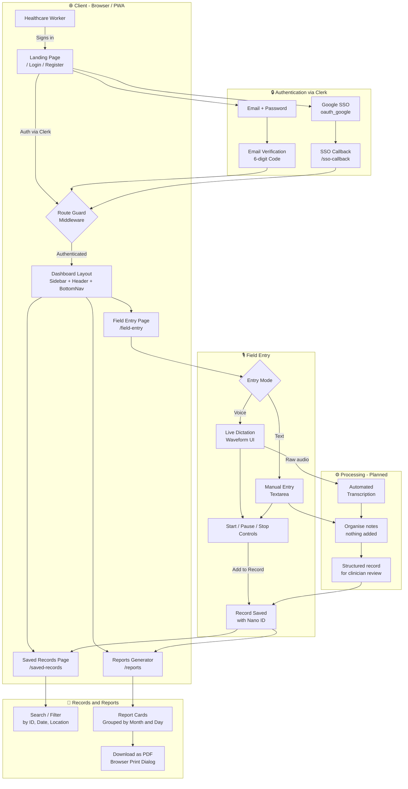

<div align="center">
  

  <br/>
  <br/>

  <p><strong>Field notes to finished reports, for frontline health teams</strong></p>

  <p>
    
    
    
    
    
  </p>

  <p>
    <em>Capture, organise and report clinical encounters in the field, even with weak internet.</em>
  </p>
</div>

---

## 🚨 The Problem

Frontline healthcare workers operating in remote camps, mobile clinics, and humanitarian outreach settings face a **critical documentation gap**:

- 📋 **Paper-based records** are error-prone, illegible, and impossible to share in real time.
- 🌐 **Poor or no internet connectivity** makes cloud-dependent tools unusable in the field.
- ⏱️ **Documentation burden** takes time away from patient care — workers spend as much time charting as treating.
- 🗣️ **Medical jargon and voice quality** degrade transcription accuracy in noisy field environments.
- 📊 **No standardised reporting** makes aggregating findings across camps nearly impossible.

The result: **critical clinical data is lost, delayed, or never recorded**, impacting patient outcomes and programme reporting.

---

## 💡 The Proposed Solution

**DaktariScribe** is a **clinical documentation and reporting tool** designed specifically for frontline healthcare workers. It bridges the gap between in-field care delivery and structured medical documentation:

| Capability | Description |
|---|---|
| 🎙️ **Voice Dictation** | Healthcare workers dictate clinical encounters hands-free during or after patient interactions |
| ✍️ **Manual Entry** | Alternatively type notes using a structured manual entry interface |
| 🗂️ **Organised Reports** | Notes are tidied into a standard record under template headings. Nothing is added; every line links back to the original. The clinician reviews and signs off |
| 📁 **Modular Records** | Encounters are grouped by camp location and date, with cryptographic Nano IDs for tamper-evident record integrity |
| 📄 **PDF Reports** | Signed records export as branded, print-quality PDF reports |
| 🔒 **Encryption & offline capture** | *Coming soon* (Phases 4 and 6 of the build spec) |

---

## 🏗️ Tech Stack

<div align="center">

| Layer | Technology | Purpose |
|---|---|---|
| **Framework** | [Next.js 16](https://nextjs.org/) (App Router) | Full-stack React framework with SSR & API routes |
| **UI Library** | [React 19](https://react.dev/) | Component-based, server & client rendering |
| **Language** | [TypeScript 5](https://www.typescriptlang.org/) | Type-safe development across the stack |
| **Styling** | [Tailwind CSS v4](https://tailwindcss.com/) | Utility-first design system with custom design tokens |
| **Authentication** | [Clerk](https://clerk.com/) | Drop-in auth: email/password, Google SSO, email verification |
| **Icons** | [Google Material Symbols](https://fonts.google.com/icons) | Outlined icon set loaded via Google Fonts CDN |
| **Typography** | Inter + Hanken Grotesk (next/font) | Body and headline fonts |
| **Database** | Neon Postgres + Drizzle ORM + Zod | Records, versions, sign-offs, audit log |
| **On-device storage** | Dexie (IndexedDB) | Drafts saved while typing |
| **PDF** | @react-pdf/renderer | Branded field reports |
| **Image Optimisation** | Next.js Image (AVIF/WebP) | Automatic format conversion and lazy loading |
| **PostCSS** | PostCSS + postcss-preset-env | CSS transformation and cross-browser compatibility |

</div>

---

## ⚙️ System Architecture

> How DaktariScribe works — from field capture to structured report.



---

## 📁 Project Structure

```
DaktariScribe/
├── app/
│   ├── (dashboard)/
│   │   ├── field-entry/          # Capture: encounter details + typed note, autosaved on the device
│   │   ├── saved-records/        # Server-paginated list with filters and status badges
│   │   ├── records/[id]/         # Record detail: version, edit, sign-off, original notes, history
│   │   ├── reports/              # Final (signed-off) records grouped by month/day, PDF download
│   │   └── layout.tsx            # Shell: Sidebar + Header + BottomNav + offline banner
│   ├── api/
│   │   ├── encounters/           # POST create (Process); [id]/versions (edit); [id]/signoff
│   │   └── exports/[id]/         # GET branded PDF (Final records only)
│   ├── register/ forgot-password/ sso-callback/ legal/
│   └── layout.tsx / page.tsx
├── components/
│   ├── capture/FieldEntry.tsx    # Type tab, autosave, drafts on this device
│   ├── records/                  # StatusBadge, RecordBody, RecordEditor, SignOffPanel
│   ├── exports/RecordPdf.tsx     # @react-pdf/renderer report layout
│   └── layout/ landing/ legal/
├── db/
│   ├── schema.ts                 # Drizzle schema (spec §4)
│   ├── migrations/               # drizzle-kit SQL migrations
│   └── seed.ts                   # Global templates
├── lib/
│   ├── auth.ts                   # Clerk wrapper → { userId, orgId, role }
│   ├── crypto.ts                 # AES-256-GCM field encryption with key versions
│   ├── records/service.ts        # All record queries, scoped by org (and by worker for workers)
│   ├── offline/db.ts             # Dexie draft store (codec-ready for Phase 4 encryption)
│   ├── templates/                # Template schema (Zod) + global templates
│   └── encounter-status.ts       # Export and sign-off gates
├── scripts/check-copy.ts         # CI check for banned "AI-looking" copy (spec §1.5)
├── proxy.ts                      # Clerk route protection (Next.js 16 "proxy", formerly middleware)
├── PRODUCT.md / DESIGN.md        # Product context and design system
└── DAKTARISCRIBE_BUILD_SPEC.md   # The phased build plan
```

---

## 🚀 Getting Started

### Prerequisites

Make sure you have the following installed:

- **Node.js** `>= 20.9` — [Download](https://nodejs.org/)
- **npm** `>= 9.x` (bundled with Node.js)
- A **Clerk** account and application — [clerk.com](https://clerk.com/)

### 1. Clone the Repository

```bash
git clone https://github.com/your-org/DaktariScribe.git
cd DaktariScribe
```

### 2. Install Dependencies

```bash
npm install
```

### 3. Configure Environment Variables

Copy `.env.example` to `.env.local` and fill in what you have. Only Clerk, `DATABASE_URL` (Neon) and `DATA_ENCRYPTION_KEY` are needed for Phase 1; the other services are added phase by phase (see `DAKTARISCRIBE_BUILD_SPEC.md` §3.1). **Never commit `.env.local`.**

```bash
cp .env.example .env.local
# generate the app encryption key
openssl rand -base64 32
```

### 4. Create the database

```bash
npm run db:migrate   # applies db/migrations to DATABASE_URL
npm run db:seed      # inserts the global templates
```

### 5. Run the Development Server

```bash
npm run dev
```

Open [http://localhost:3000](http://localhost:3000) in your browser to view the application.

### 6. Build for Production

```bash
npm run build
npm start
```

---

## 🔑 What works today (Phase 1)

- **Field Entry** (`/field-entry`): template, site, date, respondent reference, interview language and a required consent checkbox. The **Type** tab autosaves to the device every 3 s and on blur. **Save draft** keeps it on the device; **Process** creates the record on the server (retries never create duplicates). **Record** and **Upload** are marked *coming soon*.
- **Saved Records** (`/saved-records`): server-side pagination; filters for record ID, date range, site, status and (supervisors) worker.
- **Record detail** (`/records/[id]`): the current version, edits saved as new versions, sign-off by the author, the original note exactly as typed, and history.
- **Reports** (`/reports`): signed-off records grouped by month and day, each with a **PDF** download.
- **PDF report**: logo, record ID, site, date, author, sections, fields table with *Not recorded* for blanks, sign-off block, provenance line, and the confidentiality notice with page numbers on every page.

Not built yet: voice recording, uploads, automated organising of notes, offline sync, translation, Word/slide exports and billing. See the build spec for the phase plan.

---

## 🛡️ Security & Privacy (current state)

- **Access control**: every query is scoped to the user's organisation; workers see only their own records. Records outside your scope return *not found*.
- **Field encryption**: respondent references, original notes and record content are encrypted with AES-256-GCM before they are written to the database.
- **Originals are immutable**: edits create new versions; the typed original is never changed.
- **Sign-off gate**: only signed-off (Final) records can be exported, enforced on the server from the stored status.
- **Logs**: the server logger drops note text and other content fields.
- **Audit log**: record creation, views, edits, sign-off and exports are recorded (without patient content).
- Not yet: MFA, security headers/CSP, rate limiting, device encryption (Phases 4 and 6).

---

## 🤝 Contributing

1. Fork the repository
2. Create a feature branch: `git checkout -b feature/your-feature-name`
3. Commit your changes: `git commit -m 'feat: add your feature'`
4. Push to the branch: `git push origin feature/your-feature-name`
5. Open a Pull Request

---

## 📄 License

© 2026 DaktariScribe. All rights reserved.

---

<div align="center">
  
  <br/>
  <sub>Built with ❤️ for frontline healthcare workers everywhere.</sub>
</div>
