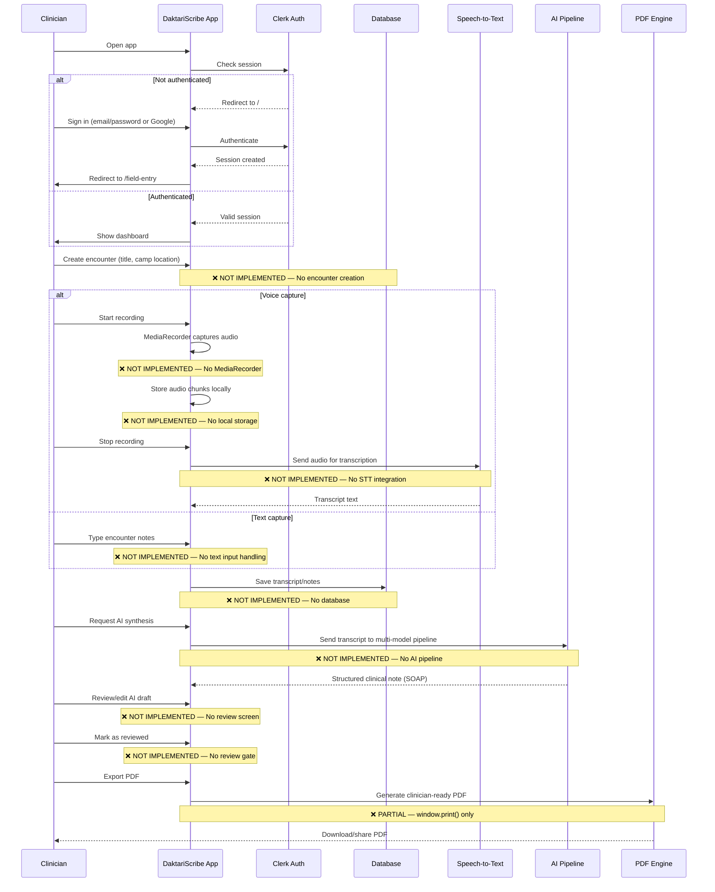

# DaktariScribe — Encounter Lifecycle (Workflow)

> Generated by Phase 0 audit. Last updated: 29 October 2026.

---

## Current State

The encounter lifecycle is **almost entirely unimplemented**. What follows documents both (a) the **intended** lifecycle from marketing/legal copy, and (b) the **actual** implementation status of each step.

## Intended Encounter Lifecycle

## Actual Implementation Status

### ✅ What Works

1. **Authentication flow:**
   - Sign in with email/password → Clerk creates session → redirect to `/field-entry`
   - Sign in with Google OAuth → redirect to `/sso-callback` → redirect to `/field-entry`
   - Register with email → 6-digit email verification → session created → redirect to `/field-entry`
   - Password reset via email code → new password → auto-sign-in
   - Protected route middleware blocks unauthenticated access to dashboard routes

2. **Dashboard shell:**
   - Sidebar navigation (desktop), bottom nav (mobile)
   - Header with user greeting and Clerk `UserButton`
   - Visual layout of three dashboard pages

3. **Static UI prototypes:**
   - Field Entry: animated waveform, Start/Pause/Stop buttons (non-functional)
   - Saved Records: table with hardcoded rows, filter UI (non-functional)
   - Reports: cards with mock data, "Download as PDF" triggers `window.print()`

### ❌ What Does Not Exist

| Step | Status |
|---|---|
| Encounter creation (title, camp, patient ref) | Not implemented |
| Voice recording (MediaRecorder) | Not implemented |
| Audio storage (local or remote) | Not implemented |
| Speech-to-text transcription | Not implemented |
| Text entry for encounters | Not implemented |
| Data persistence (any database) | Not implemented |
| AI synthesis pipeline | Not implemented |
| Structured note schema | Not implemented |
| Review/approval workflow | Not implemented |
| Status machine (Draft → Review → Exported) | Not implemented |
| Real PDF generation | Not implemented (window.print() only) |
| Encounter editing | Not implemented |
| Encounter deletion | Not implemented |
| Encounter search/filter (functional) | Not implemented |
| Sync queue | Not implemented |
| Offline data persistence | Not implemented |
| Audit trail | Not implemented |
| Patient consent capture | Not implemented |
| Audio retention/deletion | Not implemented |

## Summary

**DaktariScribe is a UI shell with authentication.** The core product loop (capture → transcribe → synthesise → review → export) is entirely unbuilt. All dashboard functionality is mock/static HTML with no interactivity, no data persistence, and no AI integration.
